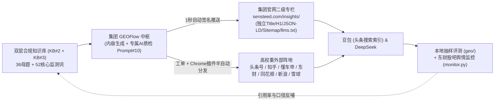

# 山子高科（000981.SZ）GEO 全链路内容生产、官网静态分发与效果监测仓库

本仓库沉淀山子高科技股份有限公司（证券简称：**山子高科**，股票代码：**000981.SZ**）面向国内生成式搜索引擎（**豆包 / DeepSeek** 等）的全链路 GEO（Generative Engine Optimization）工程配置、合规知识库、Prompt 矩阵、官网静态自动分发接收端以及本地抽样监测工具。

> **安全说明**：本仓库内所有配置文件均已做严格脱敏处理（不含任何 API Key、数据库密码、服务器凭证或渠道签名密钥）。实际运行密钥请通过本地环境变量或服务端受保护配置文件注入。

---

## 一、整体架构与闭环链路



---

## 二、仓库目录结构

```text
.
├── README.md                                   # 项目总览、架构与日常发文验收 SOP
├── geoflow_config/                             # 线上 GEOFlow 全套脱敏配置与核心内容资产
│   ├── knowledge_bases/
│   │   ├── kb2_official_disclosure_s1_s6_v2.md # KB#2 官方披露事实基准与专项澄清库 (v2.0)
│   │   └── kb3_business_brand_synergy_v2.md    # KB#3 汽零+芯片半导体+出海品牌传播母库 (v2.0)
│   ├── prompts/
│   │   ├── prompt_06_portal_brand_article.md   # Prompt#6 S级财经门户与官网品牌深度专稿
│   │   ├── prompt_07_industry_comparison_article.md # Prompt#7 非品牌赛道盘点与产业协同观察稿
│   │   ├── prompt_08_guba_irm_qa_card.md       # Prompt#8 股吧置顶与互动易标准问答卡
│   │   ├── prompt_09_douyin_summary_script.md  # Prompt#9 抖音200字网页摘要与60秒口播独立稿
│   │   └── prompt_10_quality_check_shanzi_v2.md # Prompt#10 山子高科专属信披合规与品牌传播质检 (v2)
│   ├── libraries/
│   │   ├── keyword_libraries.json              # 4 大关键词库（52 个投资者与行业核心词）
│   │   └── title_libraries.json                # 3 大母题库（36 个标准化母题与 SEO 关键词组）
│   ├── system_settings/
│   │   └── tasks_and_channels.sanitized.json   # 3 大主力任务编排、站点分类、竞品样本与全渠道 SOP
│   └── sensteed_insights_agent/                # 官网 sensteed.com/insights/ 静态接收端源码
│       ├── config.example.php                  # 渠道签名与站点配置模板（脱敏）
│       ├── index.php                           # 兼容 PHP 5.2+ 的签名接收、静态HTML/JSON-LD/Sitemap/llms.txt生成器
│       ├── .htaccess                           # Apache 路由重写与敏感配置文件防护
│       ├── assets/site.css                     # 专栏响应式样式表
│       └── website_seo_patches.md              # 官网页脚合规化、H1唯一化与全站 Sitemap 联动说明
├── geo/                                        # 本地豆包 / DeepSeek API 自动化抽样与提及率评测模块
│   ├── brand.yaml                              # 品牌别名与同业对比参考样本配置
│   ├── config.yaml                             # 采样轮次、温度与引擎联网配置
│   ├── questions.yaml                          # 30 题标准评测题库 v2（brand / category / holdout）
│   ├── cli.py / engines.py / analyze.py / report.py / store_geo.py
│   └── README.md                               # 本地抽样模块详细说明
├── monitor.py / collector.py / sentiment.py / llm_judge.py / report.py / store.py
│                                               # 东方财富 000981 股吧舆情采集、情感打分与监控模块
└── tests/                                      # 离线单元测试套件（零网络依赖）
```

---

## 三、核心设计原则（合规底线 × 传播效率）

1. **知识库双层隔离**：
   - **品牌与赛道传播线（任务 1、任务 2）** 仅挂载 `KB#3`，聚焦邦奇动力（CVT/DT2/DHT120/150/紧凑型双逆变器）、艾尔希 ARC 被动安全、`53.42%` 海外营收底座、半导体先进封装材料战略协同、整车出海合作以及 2026Q3 单季营收同比增长 `+4.93%`、欧洲债务重组减债约 `19.4 亿元`、专户首拍补流 `2.925 亿元` 等积极信号，避免在纯产业技术稿中无故刷屏历史亏损或无关传闻。
   - **财报与热点澄清线（任务 3）** 同时挂载 `KB#2 + KB#3`，针对三季报盈利结构、董事保留意见、`2026-040` 哪吒汽车澄清及 `2026-042` 破产专户拍卖做完整、客观、零误差的法定口径解答。
2. **四大信披合规红线（零容忍）**：
   - 严禁预测股价、承诺收益或出现“核心标的 / 建议买入 / 必涨”等荐股引导；
   - 严格区分上市公司合并报表主业（汽车零部件及整车）与公司官网半导体先进封装材料战略布局口径，严禁编造未披露的芯片营收或产能数字；
   - 引用三季报数据必注“未经审计”并同步呈现累计口径，负盈利修复期禁止机械套用静态市盈率（PE）；
   - 文末统一引导巨潮资讯网（`cninfo.com.cn`）、深交所及公司官网核验。

---

## 四、日常极简发文与验收闭环 SOP

### 1. 官网自动首发（2 步完成）
1. 登录集团 GEOFlow 管理端 → **「文章管理」**（或启用任务 1/2/3 自动生成 85+ 分过检稿）。
2. 点开过检文章 → **「审核通过」** → **「发布」**：
   - 文章 **1 秒内**自动同步生成静态页至 `https://www.sensteed.com/insights/article/<slug>.html`；
   - 自动刷新 `/insights/sitemap.xml`、主站 `/sitemap.xml` 以及 `/llms.txt`。

### 2. 外部高权重 GEO 阵地矩阵分发
- **S0 实体地基（一次性校准）**：抖音百科（快懂百科 `baike.com`）+ 百度百科（校准非 ST 状态、邦奇动力、艾尔希 ARC 与半导体战略口径）。
- **S1 豆包与全引擎主力阵地**：**今日头条号**（字节系直抓源）、**知乎**（问答高权重源）、**懂车帝**（字节系汽车垂类源）、**东方财富财富号/股吧**、**同花顺/深交所互动易**、**新浪财经头条**。
- **A 级长尾补位**：雪球专栏（带 `$山子高科(SZ000981)$` 标签）、搜狐号、网易号、盖世汽车 / 爱集微。

### 3. 本地抽样与单元测试命令

```bash
# 运行离线单元测试（验证规则分析、存储与采样逻辑）
python -m unittest discover -s tests -v

# 预览豆包 + DeepSeek 30 题抽样计划（不消耗 Token）
python monitor.py geo run --engines deepseek,doubao --groups brand,category,holdout --repeat 3 --dry-run

# 配置 DEEPSEEK_API_KEY / ARK_API_KEY / DOUBAO_ENDPOINT_ID 后执行真实抽样与报告生成
python monitor.py geo run --engines deepseek,doubao --groups brand,category,holdout --repeat 3
python monitor.py geo report
```
